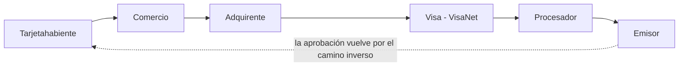

# 2. Fundamentos de pagos

## [[Modelo de quatro partes|Modelo de cuatro partes]]
La transacción es un **mensaje con varios campos** (estándar [[ISO 8583]]: `0100` solicitud, `0110` respuesta) que recorre un camino y vuelve.

- **Tarjetahabiente:** cliente, dueño de la tarjeta.
- **Comercio:** quien vende (tienda o e-commerce).
- **[[Adquirente]]:** banco del comercio; captura la transacción y la envía a la red.
- **Visa / [[VisaNet]]:** la red que transporta, chequea fraude y enruta.
- **[[Processador|Procesador]]:** interpreta el mensaje; en crédito puede aprobar en nombre del emisor.
- **[[Emissor|Emisor]]:** banco que emitió la tarjeta; verifica saldo/fraude y aprueba. La respuesta vuelve por el camino inverso.

En débito, normalmente aprueba el **banco**; en crédito, el banco o el procesador.

## La autorización no es movimiento del dinero
En la autorización el dinero **no se mueve** — la compra ya aparece en el estado de cuenta, pero al comercio todavía no se le pagó. El dinero se mueve en lotes:
- **[[Clearing]]:** intercambio y conciliación de la información de las transacciones.
- **[[Settlement]]:** liquidación — cuando el dinero efectivamente se mueve.

## [[Processador|Procesador]] × adquirente × emisor
> [!info] No confundir los roles
> **[[Emissor|Emisor]]** = banco del cliente (tarjeta, cuenta, saldo). **[[Adquirente]]** = banco del comercio. **[[Processador|Procesador]]** = empresa técnica que opera los mensajes por cuenta de un emisor O de un adquirente. [[Sistarbank]] (BROU) y [[Prisma]] (Corrientes) son procesadores emisores. Adquirente y procesador no son sinónimos, pero la misma empresa puede cumplir los dos roles.

**Analogía del teléfono:** emisor y adquirente son las dos personas que conversan; Visa es la operadora que conecta la llamada; el procesador es el aparato/central que cada una usa para transmitir la voz — infraestructura técnica, no un interlocutor.

## [[VisaNet]]
Es la red y la infraestructura de Visa por donde pasan los pagos — el "riel" entre adquirente y emisor. Es donde [[CS Implementations]] hace las configuraciones (alta de BINs, cambio de procesador).

---
[[Home]]
