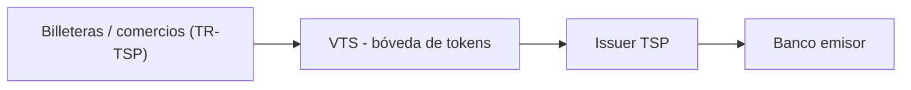

# 3. [[Tokenização|Tokenización]]

Es el "verbo" más usado: las billeteras y [[Click to Pay]] son tokenización aplicada.

## Qué es un token
En lugar del PAN (número real), se guarda un **token**. Vocabulario:
- **[[FPAN]]** — número real de la tarjeta (Funding PAN).
- **[[DPAN]]** — token en el dispositivo (Apple/Google Pay).
- **[[MPAN]]** — token vinculado a un comercio (recurrencia).
- **[[APAN]]** — token de cuenta derivado del [[DPAN]], para multicomercio.

## Arquitectura ([[VTS (Visa Token Service)|VTS]], TSP / [[ITSP]])

Visa ofrece el **[[VTS (Visa Token Service)|VTS]]**; la mayoría contrata un **TSP** (consolas, ciclo de vida de los tokens). Del lado del emisor es el **[[ITSP]]** (en Corrientes, **[[Thales]]**).

## Flujo de aprovisionamiento y APIs del emisor
Enroll Device → Enroll PAN → [[Check Eligibility]] → [[Approve Provisioning]] → Provision Token → Token Created.

APIs del emisor: [[Check Eligibility]], [[Approve Provisioning]], [[Get CVM]], [[Send Passcode]], notificaciones (Token Created, Card Metadata / PAN Update), ciclo de vida (Token Inquiry, Token/PAN Lifecycle, Update Card Metadata) y Device Token Binding ([[CTF (Cloud Token Framework)|CTF]]).

## Flujo verde × amarillo (el punto que más aparece)

| Aspecto | [[Fluxo verde (00)|Flujo verde (00)]] | [[Fluxo amarelo (85)|Flujo amarillo (85)]] |
|---|---|---|
| Decisión | Aprobación incondicional | Condicional (exige step-up) |
| Autenticación adicional | No hace falta | Sí; token inactivo hasta verificar |
| Cómo verifica | — | [[Get CVM]] → OTP ([[Send Passcode]]), call center, app-to-app |
| Cuándo ocurre | Al enrolar desde dentro de la app del banco | Al enrolar directo desde la billetera |

## Ciclo de vida y [[CTF (Cloud Token Framework)|CTF]]
Acciones (issuer host): ACTIVATE, DELETE/DEACTIVATE, SUSPEND, RESUME, UPDATE PAN EXPIRATION, UPDATE PAN-TOKEN MAPPING. **Update Card Metadata** actualiza la carátula de la tarjeta (el [[VTS (Visa Token Service)|VTS]] notifica a las billeteras). **[[CTF (Cloud Token Framework)]]** = device binding para tokens de e-commerce/CoF; **[[TAVV]]** = criptograma enviado en la transacción del token.

> [!tip] Profundización técnica
> Arquitectura VTS, las 8 APIs del emisor y el flujo de provisioning paso a paso: [[Tokenização — arquitetura VTS e provisioning (aprofundamento)|Tokenización — arquitectura VTS y provisioning (profundización)]].

---
[[Home]]
