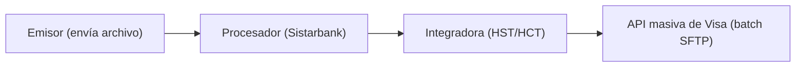

# [[Click to Pay]] — [[SRC - EMVCo|SRC]], enrolamiento y ciclo de vida (profundización)

Profundiza [[5. Click to Pay]]. Basado en el estándar **[[SRC - EMVCo|EMVCo SRC]]** (fuentes públicas) + la sesión técnica Visa·Emisor·Procesadora (fuente BROU).

## El estándar [[SRC - EMVCo|EMVCo]] SRC
[[Click to Pay]] es la marca de consumidor del **EMV Secure Remote Commerce ([[SRC - EMVCo|SRC]])**. La especificación tiene cuatro componentes: **Core Specification**, **API Specification**, **JS SDK Specification** y **UI Guidelines & Requirements** — dan una base común de enrolamiento y ciclo de vida entre emisores y sistemas de pago.

**Enrolamiento** = asociar un **PAN** a un **[[SRC - EMVCo|SRC]] Profile** (nuevo o existente). Puede ser un evento suelto o dentro del checkout.

## Participación del emisor
El emisor puede pedirle a su **procesador [[VisaNet]]** / scheme processor / **[[Third Party Agent]]** que enrole y haga el **lifecycle management** por él — fue lo que hizo el [[BROU — dossiê|BROU]] vía [[Sistarbank]] + [[HST - HCT|HST/HCT]].

## Fase 1 — [[Enrolamento massivo|Enrolamiento masivo]] (pipeline técnico)

- Con **múltiples perfiles** (varios códigos emisores), hay que **invocar las APIs una vez por perfil** — cuidado con el **[[External Consumer ID]]** redundante (el BROU tiene 4 códigos emisores).
- Spec: **"BK Batch Specification"** en el [[VDP (Visa Developer Platform)|VDP]] (pedir también el Swagger vía [[HST - HCT|HST]]).

## Fase 2 — Ciclo de vida (sin [[TPM (Technical Project Manager)|TPM]])
En los canales del emisor: **opt-out/desenrolamiento**, **actualización** de datos y de tarjetas (renovación por vencimiento, baja por robo) y **enrolamiento individual** de tarjetas nuevas (fuera del masivo). No hay contraparte técnica de Visa — investigar quién certifica.

## Checkout — autenticación
Login por **email O teléfono (OTP)** → el lookup lista **todas** las credenciales de ese contacto (cross-emisor y cross-marca). Baja fricción con **[[Passkey - App-to-App|Passkey / App-to-App]]**.

## Notificación de intento
API **"[[Click to Pay]] Enrollment Attempt Notification"** (VICA, POST): Visa avisa al emisor cuando alguien intenta enrolarse por el **[[Destination Site]]** con el enrolamiento del emisor ya habilitado.

## Fuentes oficiales (públicas)
- [EMV Secure Remote Commerce — emvco.com](https://www.emvco.com/emv-technologies/secure-remote-commerce/)
- [[[SRC - EMVCo|SRC]] / [[Click to Pay]] — emvco.com](https://www.emvco.com/emv-technologies/src/)
- [Visa [[Click to Pay]] / [[SRC - EMVCo|SRC]] — developer.visa.com](https://developer.visa.com/capabilities/visa-secure-remote-commerce/docs)

---
[[Home]]
