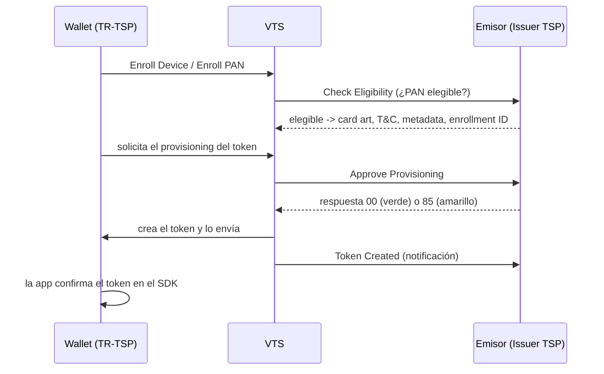

# [[Tokenização|Tokenización]] — arquitectura [[VTS (Visa Token Service)|VTS]] y provisioning (profundización)

Profundiza el concepto [[3. Tokenização|3. Tokenización]]. Basado en la **capacitación técnica de Visa** (flujos de API del lado emisor) + la norma **[[SRC - EMVCo|EMVCo]] Payment Tokenisation** (2014), que el [[VTS (Visa Token Service)|VTS]] implementa.

## Arquitectura [[VTS (Visa Token Service)|VTS]] — tres roles
El [[VTS (Visa Token Service)|VTS]] es la **plataforma/bóveda** que intercambia datos entre solicitantes de token y emisores.

| Rol | Quién | Función |
|---|---|---|
| **Token Requestor (TR-[[TSP (Token Service Provider)|TSP]])** | Billeteras (Apple/Google/Samsung/Garmin/Fitbit), comercios, e-comm/CoF | Solicita el token |
| **[[VTS (Visa Token Service)|VTS]]** | Visa | Bóveda/**generación de tokens**; procesa transacciones de token (**destokenización** y controles de dominio) |
| **Issuer TSP** | [[ITSP]] del emisor | Servicios de token del lado del banco |

Cada uno ofrece: incorporación/gestión, aprovisionamiento, ID&V, gestión del ciclo de vida y notificaciones. **Card Present** usa el **Secure Element (SE)**; **Card Not Present** usa **HCE / e-comm / CoF**.

## Las 8 APIs del lado del emisor
1. **[[Check Eligibility]]** — ¿el PAN es elegible para tokenizar?
2. **[[Approve Provisioning]]** — aprobar (00 [[Fluxo verde (00)|verde]] / 85 [[Fluxo amarelo (85)|amarillo]] / rechazar).
3. **[[Get CVM]]** — métodos de verificación en el step-up.
4. **[[Send Passcode]]** — OTP del step-up.
5. **Notifications** — Token Created, Card Metadata / PAN Update.
6. **Life Cycle Management** — ACTIVATE, SUSPEND, RESUME, DELETE, UPDATE PAN EXPIRATION.
7. **Device Token Binding** — [[CTF (Cloud Token Framework)|CTF]].
8. **Update Card Metadata** — actualiza la carátula (el [[VTS (Visa Token Service)|VTS]] notifica a las billeteras).

## Flujo de aprovisionamiento (alto nivel)

En el amarillo (85) el token queda **inactivo** hasta el step-up ([[Get CVM]] → [[Send Passcode]] / call center / app-to-app).

## [[OPC]] ([[Push - In-App Provisioning (fluxo verde)|In-App Provisioning]] API)
La API de [[Push - In-App Provisioning (fluxo verde)|In-App Provisioning]] usa un **[[OPC]] (Opaque Payment Card)** para el [[FPAN]] (número real, que puede guardarse) y aprovisiona el [[DPAN]] (token) en la billetera del dispositivo.

## Fuentes oficiales (públicas)
- [[[VTS (Visa Token Service)|Visa Token Service]] — usa.visa.com](https://usa.visa.com/products/visa-token-service.html)
- [[[VTS (Visa Token Service)|VTS]] Provisioning & Credential Management — developer.visa.com](https://developer.visa.com/capabilities/token-service-provisioning)
- [Visa [[Push - In-App Provisioning (fluxo verde)|In-App Provisioning]] API ([[OPC]]/[[DPAN]]) — developer.visa.com](https://developer.visa.com/capabilities/visa-in-app-provisioning/docs)
- [EMV Payment Tokenisation — emvco.com](https://www.emvco.com/emv-technologies/payment-tokenisation/)
> La documentación detallada del [[VTS (Visa Token Service)|VTS]] es de acceso restringido (producto restringido); las fuentes de arriba son las páginas públicas.

---
[[Home]]
